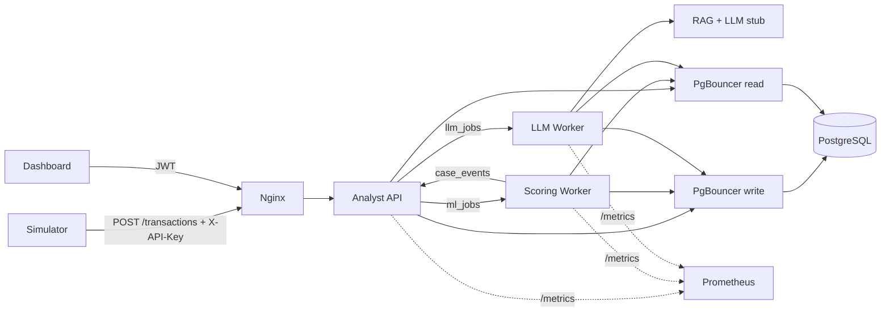

# Fraud Copilot

Fraud Copilot là một pipeline xử lý giao dịch gian lận bất đồng bộ, gồm Analyst API,
Scoring Worker, LLM Worker, Redis, PostgreSQL, PgBouncer và dashboard web cho analyst.
Toàn bộ stack có thể chạy bằng Docker Compose.

> **Trạng thái hiện tại:** hạ tầng giao tiếp, hợp đồng dữ liệu, retry/timeout,
> circuit breaker, RBAC, audit log, metrics và dashboard đã chạy được. Phần ML/RAG/LLM
> hiện là implementation mẫu (stub), được đánh dấu trong source bằng `>>> HÀM GIẢ <<<`.

## Mục lục

- [Kiến trúc](#kiến-trúc)
- [Yêu cầu](#yêu-cầu)
- [Chạy nhanh bằng Docker](#chạy-nhanh-bằng-docker)
- [Chạy và debug trong VS Code](#chạy-và-debug-trong-vs-code)
- [Dashboard](#dashboard)
- [API](#api)
- [Simulator](#simulator)
- [Cấu hình](#cấu-hình)
- [Observability](#observability)
- [Test](#test)
- [Cơ chế xử lý lỗi](#cơ-chế-xử-lý-lỗi)
- [Các phần cần thay thế](#các-phần-cần-thay-thế)
- [Cấu trúc thư mục](#cấu-trúc-thư-mục)

## Kiến trúc



Luồng chính:

1. Simulator gửi giao dịch vào Nginx. API loại bỏ `is_fraud`, chống trùng theo
   `trans_num`, gắn `trace_id` và đưa job vào Redis `ml_jobs`.
2. Scoring Worker validate dữ liệu, che PII, tính điểm và tạo case.
3. API nhận event từ `case_events`, sau đó đưa yêu cầu tạo brief vào `llm_jobs`.
4. LLM Worker tạo brief có citation; nếu LLM lỗi hoặc timeout thì dùng brief
   rule-based.
5. Analyst xem review queue trên dashboard và thực hiện các thao tác xử lý case.

Các queue dùng at-least-once delivery. Mỗi queue có vùng `ready`, `processing` và
`dead`; job hết visibility timeout sẽ được reaper đưa lại vào queue.

## Yêu cầu

- Docker Desktop có hỗ trợ Docker Compose v2
- Hoặc Python 3.12+ và Redis/PostgreSQL khi chạy service ngoài Docker
- PowerShell, bash hoặc terminal tương đương để chạy các lệnh ví dụ

## Chạy nhanh bằng Docker

Từ thư mục gốc repository:

```bash
docker compose up --build -d
docker compose ps
curl http://localhost:8080/healthz
```

Dashboard mở tại <http://localhost:8080/>.

Chạy simulator với dữ liệu tổng hợp:

```bash
docker compose --profile sim run --rm simulator --tps 10 --limit 300 --fault-rate 0.05
```

Chạy simulator với dataset có sẵn:

```bash
docker compose --profile sim run --rm simulator \
  --csv /data/fraudTrain.csv --tps 10 --limit 300 --labels /data/labels.csv
```

Xem log:

```bash
docker compose logs -f analyst-api scoring-worker llm-worker
```

Dừng stack:

```bash
docker compose down
```

Xóa cả dữ liệu PostgreSQL local (không thể khôi phục):

```bash
docker compose down -v
```

### Cổng mặc định

| Thành phần | Cổng | Ghi chú |
|---|---:|---|
| Nginx / dashboard / API gateway | `8080` | Cổng public duy nhất của stack |
| Analyst API trực tiếp | `8000` | Chỉ mở trong compose dev |
| PostgreSQL | `5432` | Chỉ mở trong compose dev |
| Redis | `6379` | Chỉ mở trong compose dev |
| PgBouncer write/read | `6432` / `6433` | Chỉ mở trong compose dev |
| Prometheus | `9090` | Chỉ mở trong compose dev |

## Chạy và debug trong VS Code

Compose dev chỉ chạy hạ tầng và mở các cổng nội bộ ra máy host:

```bash
docker compose -f docker-compose.yml -f docker-compose.dev.yml \
  up -d redis postgres pgbouncer-write pgbouncer-read
```

Sau đó chạy các process Python trong terminal hoặc VS Code:

```bash
python -m uvicorn analyst_api.main:app --host 0.0.0.0 --port 8000
python -m scoring_worker.main
python -m llm_worker.main
```

Nếu chạy ngoài Docker, các giá trị mặc định trong `fraud_common/config.py` sẽ
trỏ tới Redis `localhost:6379` và PgBouncer `localhost:6432/6433`. Có thể đặt
biến môi trường trước khi khởi động process nếu dùng endpoint khác.

## Dashboard

Dashboard được serve bởi Analyst API tại `/`. Sau khi đăng nhập, màn hình review
queue hỗ trợ:

- lọc theo risk level và trạng thái;
- xem confidence, trạng thái brief và chi tiết transaction đã che PII;
- thêm note, yêu cầu thêm thông tin, xác nhận simulated hoặc escalate;
- risk lead xử lý case escalated;
- analyst/risk lead yêu cầu tạo lại brief trong giới hạn cấu hình.

Một số ô giao diện hiện là thông tin mẫu hoặc chưa nối backend (ví dụ analytics,
audit trail và queue latency).

## API

API JSON có prefix `/api/v1`. Tài liệu OpenAPI tự sinh ở
<http://localhost:8000/docs> khi dùng compose dev; qua Nginx có thể dùng
<http://localhost:8080/docs>.

### Đăng nhập

```bash
curl -s http://localhost:8080/api/v1/auth/login \
  -H "content-type: application/json" \
  -d "{\"username\":\"analyst1\",\"password\":\"analyst123\"}"
```

Tài khoản demo:

| Username | Password | Role |
|---|---|---|
| `analyst1` | `analyst123` | Analyst |
| `analyst2` | `analyst123` | Analyst |
| `lead1` | `lead123` | Risk Lead |
| `admin` | `admin123` | Admin |

Lưu `access_token` từ response rồi dùng header `Authorization: Bearer <token>`.
Các mật khẩu trên chỉ dành cho demo; production cần thay bằng user store và
mật khẩu đã hash.

### Các endpoint chính

| Method | Path | Quyền | Mô tả |
|---|---|---|---|
| `POST` | `/api/v1/auth/login` | Public | Đăng nhập, nhận JWT |
| `POST` | `/api/v1/transactions` | `X-API-Key` | Queue giao dịch để chấm điểm |
| `GET` | `/api/v1/transactions/{txn_id}/result` | API key hoặc JWT | Lấy kết quả bất đồng bộ |
| `GET` | `/api/v1/cases` | Analyst, Risk Lead | Review queue, High trước |
| `GET` | `/api/v1/cases/{case_id}` | Analyst, Risk Lead | Chi tiết case và lịch sử thao tác |
| `POST` | `/api/v1/cases/{case_id}/actions` | Analyst | `NOTE`, `NEEDS_MORE_INFO`, `CONFIRM_SIMULATED`, `ESCALATE` |
| `POST` | `/api/v1/cases/{case_id}/resolve` | Risk Lead | `CLOSE` hoặc `RETURN` case escalated |
| `POST` | `/api/v1/cases/{case_id}/brief:regenerate` | Analyst, Risk Lead | Queue tạo lại brief |
| `GET` / `PUT` | `/api/v1/admin/threshold-config` | Admin | Đọc/cập nhật ngưỡng risk có version |
| `GET` | `/api/v1/admin/queues` | Admin | Độ sâu các queue |
| `GET` | `/healthz` | Public | Health check |
| `GET` | `/metrics` | Internal | Prometheus metrics |

Ví dụ lấy queue:

```bash
curl -s http://localhost:8080/api/v1/cases \
  -H "Authorization: Bearer YOUR_TOKEN"
```

Ví dụ chuyển case lên risk lead:

```bash
curl -s -X POST http://localhost:8080/api/v1/cases/1/actions \
  -H "Authorization: Bearer YOUR_TOKEN" \
  -H "content-type: application/json" \
  -d "{\"action\":\"ESCALATE\",\"note\":\"Cần risk lead kiểm tra\"}"
```

## Simulator

Simulator không gửi nhãn `is_fraud` vào API; nhãn được ghi riêng vào file CSV
`data/labels.csv`. Nếu không truyền `--csv`, simulator tự sinh dữ liệu deterministic.

```bash
python -m simulator.replay --url http://localhost:8080 --tps 10 --limit 500
python -m simulator.replay --csv data/fraudTrain.csv --tps 50 \
  --limit 1000 --fault-rate 0.02 --concurrency 100
```

| Option | Mặc định | Ý nghĩa |
|---|---:|---|
| `--url` | `http://localhost:8080` | Base URL của gateway |
| `--csv` | không có | Dataset Sparkov/fraudTrain tương thích |
| `--tps` | `10` | Tốc độ phát giao dịch |
| `--limit` | `500` | Số dòng; `0` là toàn bộ |
| `--fault-rate` | `0` | Tỉ lệ payload bị tiêm lỗi |
| `--concurrency` | `100` | Số request đồng thời tối đa |
| `--labels` | `data/labels.csv` | File lưu nhãn thật |

## Cấu hình

Compose đã cung cấp các giá trị mặc định phù hợp cho local development. Production
cần thay tối thiểu `JWT_SECRET`, `SIMULATOR_API_KEY`, `PII_SALT` và thông tin
PostgreSQL bằng secret manager hoặc environment injection.

| Biến | Mặc định | Mục đích |
|---|---|---|
| `REDIS_URL` | `redis://localhost:6379/0` | Redis connection |
| `DB_WRITE_URL` | PgBouncer write local | Kết nối ghi DB |
| `DB_READ_URL` | PgBouncer read local | Kết nối đọc DB |
| `JWT_SECRET` | `dev-only-change-me` | Ký JWT |
| `JWT_TTL_S` | `28800` | Thời hạn JWT (giây) |
| `SIMULATOR_API_KEY` | `dev-sim-key` | Xác thực simulator |
| `PII_SALT` | `dev-salt` | Hash định danh PII |
| `MAX_ML_QUEUE_DEPTH` | `5000` | Ngưỡng trả HTTP 429 |
| `ML_CONCURRENCY` | `8` | Worker ML đồng thời |
| `ML_JOB_TIMEOUT_S` | `2` | Timeout job ML |
| `ML_MAX_ATTEMPTS` | `3` | Số lần thử job ML |
| `LLM_CONCURRENCY` | `2` | Worker LLM đồng thời |
| `LLM_JOB_TIMEOUT_S` | `30` | Timeout job LLM |
| `LLM_MAX_ATTEMPTS` | `3` | Số lần thử job LLM |
| `BRIEF_TOKEN_BUDGET` | `5000` | Ngân sách brief |
| `REGEN_LIMIT_PER_HOUR` | `3` | Số lần regenerate/case/giờ |
| `LLM_PROVIDER` | `stub` | Provider LLM hiện tại |
| `LLM_STUB_LATENCY_S` | `1.0` | Độ trễ giả lập |
| `LLM_STUB_FAIL_RATE` | `0.0` | Tỉ lệ lỗi giả lập |

Để thử circuit breaker và fallback:

```bash
LLM_STUB_FAIL_RATE=0.5 docker compose up -d --build
```

## Observability

- `GET /healthz`: kiểm tra API còn kết nối Redis.
- Prometheus scrape Analyst API tại `/metrics/`.
- Worker expose metrics ở `METRICS_PORT` (`9101` cho scoring, `9102` cho LLM).
- `X-Request-Id` được truyền thành `trace_id` qua queue, log và audit record.
- Redis queue có thống kê `ready`, `processing`, `dead` qua endpoint admin.

Prometheus mở tại <http://localhost:9090> khi chạy compose dev.

## Test

Test logic không cần hạ tầng:

```bash
python -m pytest tests/test_logic.py -q
```

Test toàn bộ:

```bash
python -m pytest -q
```

`tests/test_queue_integration.py` sẽ tự skip nếu Redis chưa chạy. Để chạy test
integration, mở Redis bằng:

```bash
docker compose -f docker-compose.yml -f docker-compose.dev.yml up -d redis
python -m pytest tests/test_queue_integration.py -q
```

## Cơ chế xử lý lỗi

- Giao dịch trùng trong một giờ trả `200 DUPLICATE`.
- ML queue đầy trả `429` kèm `Retry-After`.
- Job ML lỗi quá số lần thử được đưa vào manual fallback.
- Job LLM timeout được đánh dấu `FAILED_TIMEOUT` và tạo brief rule-based.
- Job đang xử lý nhưng worker chết sẽ được requeue bởi visibility-timeout reaper.
- Các handler được thiết kế idempotent để an toàn với at-least-once delivery.
- Giao dịch và brief không đưa nhãn `is_fraud` vào luồng suy luận; transaction
  hiển thị cho analyst đã được che PII.

## Các phần cần thay thế

| File | Hiện tại | Cần thay bằng |
|---|---|---|
| `scoring_worker/pipeline/inference.py` | Điểm giả theo công thức | Model và calibrator từ Model Store |
| `scoring_worker/pipeline/features.py` | Một số feature đơn giản | Feature engineering production |
| `llm_worker/llm_client.py` | `StubLLMClient` | Client LLM thật/local |
| `llm_worker/rag.py` | Bốn đoạn playbook mẫu | Vector index/RAG thật |
| `llm_worker/grounding.py` | Kiểm tra citation cơ bản | Kiểm chứng số liệu và grounding sâu hơn |
| `analyst_api/auth.py` | User hard-code | User table và password hash |

Khi thay implementation, giữ nguyên interface và schema trong
`fraud_common/schemas.py` để không phá vỡ contract giữa các service.

## Cấu trúc thư mục

```text
analyst_api/       API, auth, case actions, admin và event consumer
fraud_common/      config, DB, schema, queue, metrics, resilience
scoring_worker/    validation, PII masking, feature và scoring pipeline
llm_worker/        RAG, grounding, LLM client và brief worker
simulator/         replay dataset hoặc dữ liệu tổng hợp
db/                PostgreSQL schema khởi tạo
nginx/             gateway và routing
prometheus/        Prometheus scrape config
static/            dashboard frontend
tests/             unit test và Redis queue integration test
```
