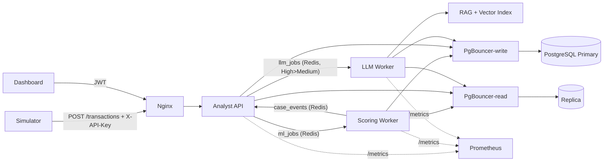

# Fraud Copilot – Khung giao tiếp giữa các thành phần

Khung chạy được bằng Docker Compose. Phần **giao tiếp** (API, hàng đợi Redis, hợp đồng dữ liệu, retry/timeout/circuit breaker, ghi DB qua PgBouncer, metrics) đã làm thật.
Phần **nghiệp vụ AI** là hàm giả, có đánh dấu `>>> HÀM GIẢ <<<`, chỉ cần thay thân hàm, giữ nguyên chữ ký.

## 1. Sơ đồ giao tiếp



## 2. Chạy

**Cách A – toàn bộ trong Docker** (cần Docker Desktop):
```bash
docker compose up --build -d
docker compose --profile sim run --rm simulator --tps 10 --limit 300 --fault-rate 0.05
curl http://localhost:8080/healthz
```

**Cách B – chạy/debug Python trong VS Code** (hạ tầng trong Docker, code chạy trên máy):
Chạy file tasks.json trong phần .vscode
## 3. Thử nhanh bằng curl
```bash
# 1) đăng nhập analyst
TOKEN=$(curl -s localhost:8080/api/v1/auth/login -H 'content-type: application/json' \
  -d '{"username":"analyst1","password":"analyst123"}' | python -c "import sys,json;print(json.load(sys.stdin)['access_token'])")
# 2) hàng đợi ưu tiên
curl -s localhost:8080/api/v1/cases -H "Authorization: Bearer $TOKEN"
# 3) chi tiết case (giao dịch đã che PII, điểm, giải thích, brief)
curl -s localhost:8080/api/v1/cases/1 -H "Authorization: Bearer $TOKEN"
# 4) chuyển cấp
curl -s -X POST localhost:8080/api/v1/cases/1/actions -H "Authorization: Bearer $TOKEN" \
  -H 'content-type: application/json' -d '{"action":"ESCALATE","note":"nghi ngờ"}'
```
Tài khoản demo (trong `analyst_api/auth.py`): `analyst1/analyst123`, `lead1/lead123`, `admin/admin123`.
Tài liệu API tự sinh: `http://localhost:8000/docs` (chỉ khi mở cổng bằng file dev).

## 4. Dashboard

Dashboard Fraud Copilot được phục vụ tại `http://localhost:8080/` khi chạy Docker Compose:

```bash
docker compose up --build -d
```

Đăng nhập bằng tài khoản demo `analyst1 / analyst123` hoặc `lead1 / lead123`.
Dashboard gọi trực tiếp các API `/api/v1/cases`, hiển thị hàng đợi ưu tiên, bộ lọc,
chi tiết case và các thao tác analyst. Khi có dữ liệu trong PostgreSQL, các case sẽ
được hiển thị trong review queue.

## 5. Hợp đồng giao tiếp

### REST (qua Nginx, tiền tố `/api/v1`)
| Method & đường dẫn | Ai gọi | Quyền | Ghi chú |
|---|---|---|---|
| `POST /transactions` | Simulator | `X-API-Key` | 202 QUEUED · 200 DUPLICATE · 429 hàng đợi đầy (có `Retry-After`) |
| `GET /transactions/{id}/result` | Simulator/UI | key hoặc JWT | 202 PENDING nếu chưa chấm xong |
| `POST /auth/login` | UI | – | trả JWT |
| `GET /cases` | Analyst, Risk Lead | JWT | sắp xếp High trước, xác suất giảm dần; Risk Lead mặc định chỉ thấy ESCALATED |
| `GET /cases/{id}` | Analyst, Risk Lead | JWT | giao dịch, điểm, SHAP-like, brief, lịch sử thao tác |
| `POST /cases/{id}/actions` | Analyst | JWT | NOTE · NEEDS_MORE_INFO · CONFIRM_SIMULATED · ESCALATE |
| `POST /cases/{id}/resolve` | Risk Lead | JWT | CLOSE · RETURN (chỉ case ESCALATED) |
| `POST /cases/{id}/brief:regenerate` | Analyst, Risk Lead | JWT | tối đa 3 lần/giờ/case |
| `GET/PUT /admin/threshold-config` | Admin | JWT | mỗi lần PUT tạo version mới |
| `GET /admin/queues` | Admin | JWT | độ sâu 3 hàng đợi |

### Hàng đợi Redis (phong bì `JobEnvelope`, xem `fraud_common/schemas.py`)
| Queue | Producer → Consumer | job_type | Ưu tiên | Timeout / thử lại |
|---|---|---|---|---|
| `ml_jobs` | Analyst API → Scoring Worker | `score_transaction` | FIFO | 2 s / 3 lần, quá thì ghi `MANUAL_FALLBACK_UNSCORED` |
| `case_events` | Scoring Worker → Analyst API | `case_created` | High trước | 30 s / 5 lần |
| `llm_jobs` | Analyst API → LLM Worker | `generate_brief` | High (0) trước Medium (1) | 30 s / 3 lần, quá thì `FAILED_TIMEOUT` + brief rule-based |

Mỗi queue gồm `:ready` (ZSET), `:processing` (HASH, có deadline) và `:dead` (LIST). Lấy job là thao tác nguyên tử bằng Lua script; worker chết thì reaper trả job về hàng đợi. Cơ chế là **at-least-once**, vì vậy mọi handler đều idempotent (`ON CONFLICT DO NOTHING`).

`trace_id` đi xuyên suốt: Nginx `X-Request-Id` → job → log → cột `trace_id` trong DB.

### Quyền ghi DB
| Tiến trình | Bảng được ghi |
|---|---|
| scoring-worker | `transactions`, `scoring_results`, `cases` (tạo), `unscored_queue` |
| analyst-api | `case_actions`, `cases` (đổi trạng thái), `case_briefs` (tạo PENDING), `threshold_configs` |
| llm-worker | `case_briefs` (cập nhật kết quả) |
| cả ba | `audit_log` (chỉ INSERT) |

## 6. Những phần cần thay thế
| File | Hiện tại | Thay bằng |
|---|---|---|
| `scoring_worker/pipeline/inference.py` | xác suất giả theo công thức | nạp model + calibrator từ Model Store |
| `scoring_worker/pipeline/features.py` | vài đặc trưng đơn giản (đã query lịch sử đúng `t_history < t_current`) | đặc trưng thật cho mô hình |
| `llm_worker/llm_client.py` | `StubLLMClient` | client gọi API/local LLM (giữ `LLMClient.generate`) |
| `llm_worker/rag.py` | 4 đoạn playbook giả | truy vấn Vector Index |
| `llm_worker/grounding.py` | kiểm tra citation ∈ ngữ cảnh RAG | kiểm tra số liệu, chống ảo giác sâu hơn |
| `analyst_api/auth.py` | user cứng trong code | bảng `users` + băm mật khẩu |

Để thử các đường lỗi: `LLM_STUB_FAIL_RATE=0.5` (circuit breaker, FAILED_TIMEOUT) · `--fault-rate 0.1` ở simulator (MANUAL_FALLBACK_UNSCORED) · tăng `--tps` để thấy 429 backpressure.

